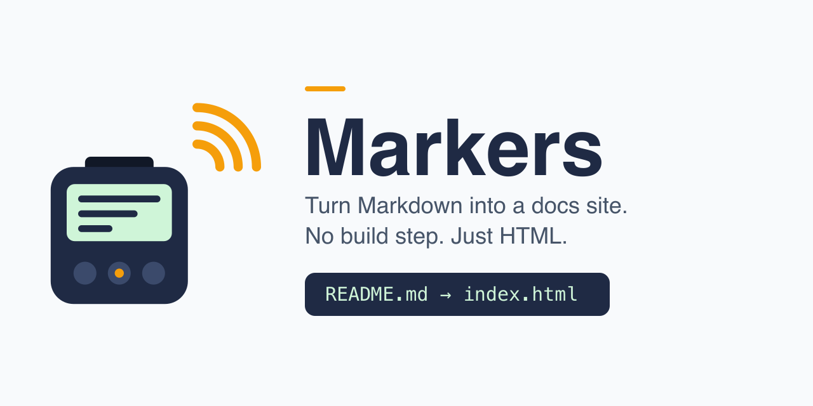
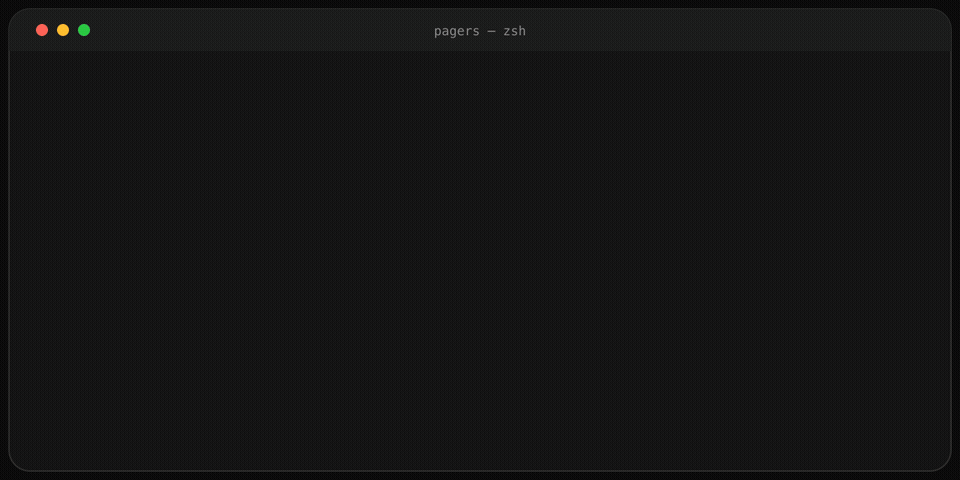

# markers

[](https://github.com/hieudoanm/markers/actions/workflows/ci.yaml?branch=master) [](LICENSE)

Topics: `static-site-generator`, `markdown`, `rust`, `documentation`, `cli`

> Write Markdown. Run one command. Get a website — and a map of how it links together.

`markers` is a static site generator for documentation, inspired by
[docsify](https://docsify.js.org) and the Go `pagify` tool it replaces. Point
it at a folder of Markdown and it produces a complete static site: clean URLs,
file-tree navigation, search-free reading, light/dark themes, and a generated
**graph page** showing how every page links to every other.

```bash
markers build ./docs
```

No configuration, no Node.js, no runtime dependencies — one Rust binary.



**Live demo:** <https://hieudoanm.github.io/markers/>



## Table of Contents

- [markers](#markers)
  - [Table of Contents](#table-of-contents)
  - [Features](#features)
  - [markers vs docsify](#markers-vs-docsify)
  - [Get Started](#get-started)
  - [Commands](#commands)
  - [Zero configuration](#zero-configuration)
  - [Frontmatter](#frontmatter)
  - [Markdown features](#markdown-features)
  - [The graph page](#the-graph-page)
  - [Documentation](#documentation)
  - [Theming](#theming)
  - [Output](#output)
  - [Development](#development)
  - [Layout](#layout)
    - [MCP server](#mcp-server)
  - [License](#license)

## Features

- **Zero configuration** — the directory layout is the config; `index.md`
  files become landing pages, folders become nav groups.
- **Clean URLs** — every page publishes at `/section/page/` (`index.html`
  inside), so `dist/` works on any static host with no rewrite rules.
- **File-tree navigation** — sidebar generated from the content tree;
  frontmatter `order`/`label`/`draft` control sorting and visibility.
- **GitHub-flavoured Markdown** — tables, task lists, footnotes,
  strikethrough, `{#heading-ids}`, GitHub alerts, and internal `.md`
  links rewritten to clean URLs at build time.
- **Eight built-in themes** — light/dark plus six palettes, all embedded in
  the binary; a toggle persists in `localStorage` and respects
  `prefers-color-scheme`.
- **Graph page** — every build writes an interactive `graph.html` mapping
  how pages link to each other; `markers graph` exports HTML/JSON/DOT.
- **`basePath` support** — deploy under any sub-path (e.g. GitHub Pages
  project sites) with one frontmatter field.
- **Wikipedia import** — `markers wiki convert`/`info` turn articles into
  Markdown; `scripts/examples.sh` crawls whole link graphs.
- **MCP server** — `markers-mcp` exposes build/inspect tools to AI agents.

See the full list in [features](packages/landing/docs/guide/features.md).

## markers vs docsify

`markers` is inspired by [docsify](https://docsify.js.org) but takes the
opposite approach: docsify renders Markdown **in the browser at runtime**
(one `index.html` + JS), while `markers` compiles to **static HTML ahead of
time** — faster pages, works without JavaScript, cacheable, and deployable
to literally any static host.

|                 | docsify           | markers                 |
| --------------- | ----------------- | ----------------------- |
| Output          | runtime JS render | static HTML files       |
| Requires JS     | yes               | no (progressive)        |
| Build step      | none              | `markers build`         |
| Config          | `window.$docsify` | directory + frontmatter |
| Search          | plugin            | —                       |
| Page-link graph | —                 | built-in `graph.html`   |
| Language        | JavaScript        | Rust (one binary)       |

## Get Started

```bash
cargo install --path .
# or
cargo build --release && cp target/release/markers ~/.local/bin/
```

## Commands

| Command                      | What it does                                                  |
| ---------------------------- | ------------------------------------------------------------- |
| `markers init [dir]`         | Scaffold `dir/docs` with example pages                        |
| `markers build [content]`    | Build the site into `./dist`                                  |
| `markers serve [content]`    | Build, then serve on localhost                                |
| `markers graph [content]`    | Write the link graph standalone (`graph.html`/`.json`/`.dot`) |
| `markers wiki convert <url>` | Convert a Wikipedia article to Markdown                       |
| `markers wiki info <url>`    | Show article metadata                                         |
| `markers landing …`          | Build a single-file landing page from `landing.yaml`          |

```bash
markers init my-site
markers build my-site/docs --output my-site/dist
markers serve my-site/docs --port 8080
markers graph my-site/docs            # graph.html + graph.json + graph.dot

# Wikipedia → Markdown
markers wiki convert "https://en.wikipedia.org/wiki/Rust_(programming_language)"
markers wiki convert "https://fr.wikipedia.org/wiki/Caf%C3%A9" -o cafe.md
markers wiki convert "https://en.wikipedia.org/wiki/Rust_(programming_language)" --format json
markers wiki convert "https://en.wikipedia.org/wiki/Rust_(programming_language)" --include-references
markers wiki info "https://en.wikipedia.org/wiki/Rust_(programming_language)"
```

## Zero configuration

The directory layout is the whole configuration:

```text
docs/
├── index.md              → /
├── getting-started.md    → /getting-started/
└── guide/
    ├── index.md          → /guide/
    └── installation.md   → /guide/installation/
```

`index.md`/`README.md` become directory landing pages, every other `.md`/
`.markdown` file a page, and all non-Markdown files are copied through as
assets. A content directory with no `index.md` still gets a generated landing
page listing the navigation.

## Frontmatter

All fields optional; the title falls back to the first `#` heading, then the
file name.

```yaml
---
title: Getting Started
description: Learn the basics.
order: 1
label: Start here
draft: false
---
```

The index page additionally accepts site-wide fields: `language`,
`basePath`, `theme` (`light` or `dark`), `footer`. The same fields can live in
`markers.yaml` instead.

## Markdown features

GitHub-flavoured Markdown via `pulldown-cmark`: tables, task lists,
strikethrough, footnotes, raw HTML, automatic heading ids, `{#custom-id}`
heading attributes, and GitHub alerts:

```markdown
> [!NOTE]
> Rendered as a styled callout.
```

Links between Markdown files (`[x](../other.md)`, `[x](dir/)`,
`[x](/abs/path.md)`) are rewritten to the clean trailing-slash URLs the site
publishes at. Broken links are left untouched so they stay visible.

## The graph page

Every build writes `graph.html` at the site root (linked from the header): an
interactive force-directed map of page-to-page links, with node details and
dark/light theming. `markers graph` writes the same data standalone in HTML,
JSON or Graphviz DOT.

## Documentation

The full docs live in [`packages/landing/docs/`](packages/landing/docs/) and are deployed to GitHub Pages:

- [Features](packages/landing/docs/guide/features.md) · [Getting started](packages/landing/docs/guide/getting-started.md) ·
  [Commands](packages/landing/docs/guide/commands.md) · [Configuration](packages/landing/docs/guide/configuration.md)
- [Markdown](packages/landing/docs/content/markdown.md) · [Theming](packages/landing/docs/content/theming.md) ·
  [Graph](packages/landing/docs/content/graph.md) · [Wikipedia](packages/landing/docs/content/wiki.md)
- [MCP server](packages/landing/docs/project/mcp.md) · [Scripts](packages/landing/docs/project/scripts.md) ·
  [Deploy](packages/landing/docs/project/deploy.md) · [Architecture](packages/landing/docs/project/architecture.md)

## Theming

Markdown typography and its palettes come from
[`md.css`](https://github.com/hieudoanm/markers/tree/main/packages/md.scss) —
the Sass module migrated into this repo at `packages/md.scss` (light default,
`md-dark`, plus six colour themes), with the compiled stylesheet embedded in
the binary.
The site chrome has its own light/dark tokens. The theme toggle persists in
`localStorage` and respects `prefers-color-scheme`.

## Output

```text
dist/
├── index.html
├── guide/installation/index.html
├── graph.html
├── robots.txt        # generated site metadata (content file wins)
├── sitemap.xml       # generated; absolute URLs when `url` is set
├── humans.txt        # generated
├── favicon.ico       # generated from the embedded PNG mark
├── site.webmanifest  # PWA/install metadata
├── llms.txt / ai.txt # LLM-friendly index + crawler policy
└── .well-known/      # security.txt, assetlinks, apple-app-site-assoc
└── assets/           # md.css, styles.css, script.js, favicon.svg
```

Deploy `dist/` to any static host — GitHub Pages, Cloudflare Pages, Netlify,
Vercel, or a plain web server.

## Development

```bash
cargo build            # debug binary
cargo test             # unit tests
cargo clippy           # lints
cargo fmt              # formatting
```

## Layout

A Cargo workspace: two binaries plus six library crates.

```text
crates/
├── markers-cli/        # markers binary: CLI, build, serve, init, wiki
├── markers-mcp/        # markers-mcp binary: MCP server over stdio
├── markers-build/      # build pipeline: discover → render → write → graph
├── markers-site/       # discovery, page model, URLs, nav, link resolution,
│                      #   frontmatter, markers.yaml config (no deps)
├── markers-markdown/   # Markdown → HTML: outlines, alerts, link rewriting
├── markers-theme/      # embedded md.css + site chrome + page template
├── markers-graph/      # page-link graph extraction and rendering
└── markers-wiki/       # Wikipedia → Markdown: REST client, extractor,
                       #   converter, normalizer
```

The root `Cargo.toml` is a virtual workspace; `markers-cli` ships the
`markers` binary and `markers-mcp` the `markers-mcp` binary, both via
`[[bin]]`.

Dependency direction: `markers-cli`/`markers-mcp` → `markers-build`/
`markers-theme`/`markers-graph` → `markers-markdown` → `markers-site`.

### MCP server

`markers-mcp` speaks the Model Context Protocol on stdio. Point an MCP
client at the binary to let it build sites and inspect content:

```json
{
  "mcpServers": {
    "markers": {
      "command": "markers-mcp"
    }
  }
}
```

Tools: `markers_build` (build a site), `markers_list_pages`,
`markers_render_markdown`, `markers_site_graph`, `markers_site_config`.

## License

This project is licensed under the [MIT License](LICENSE).

### Streamable HTTP

`markers-mcp --http 127.0.0.1:8080` also accepts `--http <addr>` (and `--token <token>`, or the
`MCP_AUTH_TOKEN` environment variable) to serve the same MCP surface over
streamable HTTP at `http://<addr>/mcp` — the transport used by ChatGPT
connectors and remote Claude clients. When a token is configured, every
request must carry `Authorization: Bearer <token>`.
